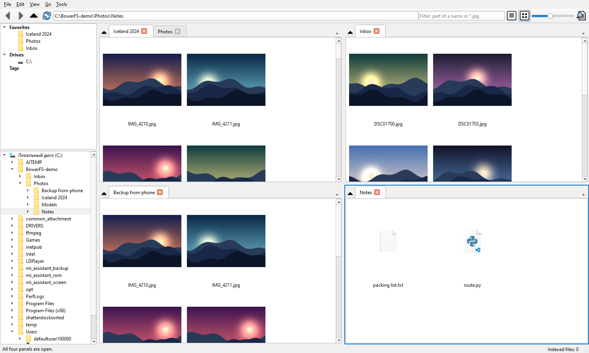
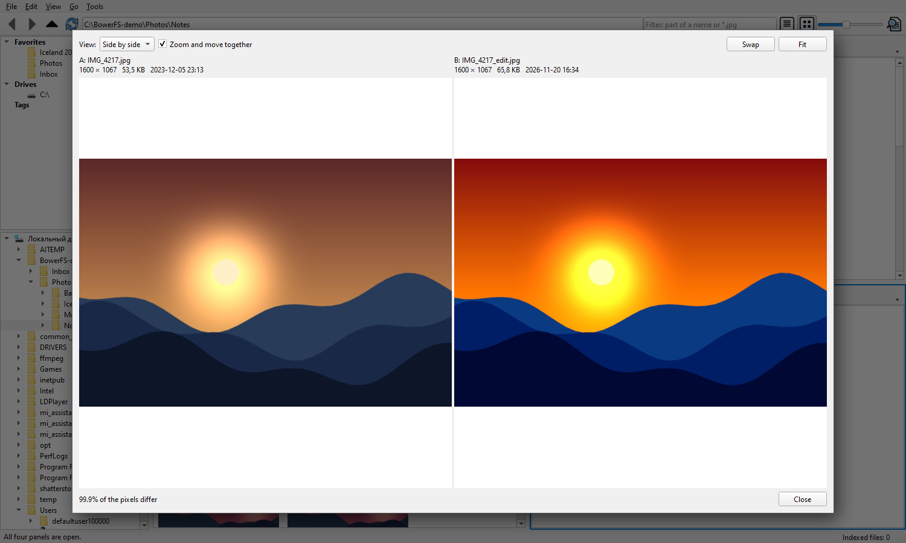
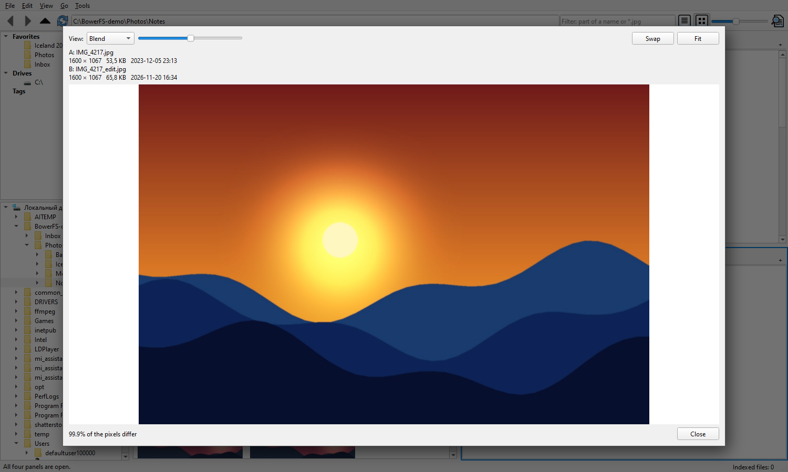

# BowerFS: alle Funktionen

[English](FEATURES.md) · **Deutsch** · [Українська](FEATURES.uk.md) · [Zurück zur README](README.de.md)

Dies ist die ausführliche Beschreibung von allem, was BowerFS 0.1.0 kann, in der Reihenfolge, in der
man es im Programm antrifft. Die Tasten sind die Standardwerte; jede Taste lässt sich unter
*Extras → Einstellungen → Tastenkürzel* ändern.

**Inhalt:**
[Fenster und Navigation](#1-fenster-und-navigation) ·
[Ansichten und Auswahl](#2-ansichten-und-auswahl) ·
[Vorschau](#3-vorschau) ·
[Dateivorgänge](#4-dateivorgänge) ·
[Stapel-Umbenennung](#5-stapel-umbenennung) ·
[Nach Regeln sortieren](#6-nach-regeln-sortieren) ·
[Suche](#7-suche) ·
[Tags](#8-tags-und-favoriten) ·
[Duplikate](#9-duplikate) ·
[Vergleich](#10-zwei-dateien-vergleichen) ·
[Einstellungen](#11-einstellungen) ·
[Daten und Sicherheit](#12-daten-und-sicherheit) ·
[Formate](#13-unterstützte-formate) ·
[Noch nicht](#14-noch-nicht)

---

## 1. Fenster und Navigation

### Fenster und Tabs
- Das Programmfenster enthält **bis zu vier Bereiche** („Fenster“): zwei oben und zwei unten.
  *Datei → Weiteres Fenster öffnen* (Strg+Umschalt+N) öffnet den nächsten freien auf dem aktuellen
  Ordner; mit **Tab** springt der Fokus zum nächsten offenen Fenster. Das aktive Fenster hat einen
  blauen Rahmen.
- Jedes Fenster hat **eigene Tabs**. Strg+T öffnet einen Tab im aktuellen Ordner, Strg+W schließt
  ihn. Jeder Tab lässt sich schließen; ein Fenster ohne Tabs verschwindet, ebenso eine leere Reihe.
  Der allerletzte Tab des Programms bleibt offen.
- Ein Tab zeigt **einen Ordner oder eine Ergebnisliste** (einer Suche oder alle Dateien mit einem Tag).
- Der Pfeil links neben den Tabs führt **einen Ordner nach oben** (auch Rücktaste).
- Das Programm **merkt sich die Sitzung**: Fenster, Tabs, Ordner, aktives Fenster, Fenstergröße,
  Trennerpositionen und ob die Vorschau offen ist. Beim nächsten Start wird alles wiederhergestellt.

### Adressleiste, Verlauf, Favoriten
- Geben Sie in die **Adressleiste** (Strg+L) einen Pfad ein oder fügen Sie ihn ein und drücken Sie
  Enter. Lange Pfade (über 260 Zeichen) und Unicode-Namen funktionieren.
- **Zurück / Vor** (Alt+←, Alt+→) gehen durch den Verlauf des Tabs. **Aktualisieren** ist Strg+R; die
  Liste aktualisiert sich auch selbst, wenn sich im Ordner etwas ändert.
- Die Seitenleiste hat über dem Ordnerbaum drei Gruppen: **Favoriten** (Strg+B fügt den aktuellen
  Ordner hinzu; Rechtsklick entfernt ihn), **Laufwerke** (mit freiem und gesamtem Platz im Tipp)
  und **Tags**.

### Ordnerbaum
- Ein Klick öffnet den Ordner im aktuellen Tab. Ein **Mittelklick** oder Rechtsklick → *In neuem Tab
  öffnen* / *In neuem Fenster öffnen* öffnet ihn getrennt.

### Statusleiste
- Die untere Zeile zeigt die Zahl der Elemente, Anzahl und Gesamtgröße der markierten und rechts die
  Zahl der **indizierten Dateien** (siehe [Duplikate](#9-duplikate)).

---

## 2. Ansichten und Auswahl

### Liste und Miniaturansichten
- Die **Liste** (Strg+1) hat die Spalten *Name, Größe, Typ, Geändert, Aufnahmedatum, Tags,
  Duplikat, Ordner*. Ein Klick auf die Spaltenüberschrift sortiert; Namen werden natürlich sortiert
  (`IMG_2` vor `IMG_10`).
- **Miniaturansichten** (Strg+2) zeigen Bilder; der Regler in der Werkzeugleiste ändert ihre Größe
  von 64 bis 384 Pixel. Miniaturen gibt es für Bilder, RAW, PSD/SVG/AI, 3D-Modelle, Video, PDF und
  Schriften. Sie liegen in einer SQLite-Datei, daher öffnet sich ein Ordner beim zweiten Mal schnell.
- Fährt man in der Miniaturansicht mit der Maus über ein **Video**, läuft man durch eine
  **Bildfolge** (braucht FFmpeg, siehe [Formate](#13-unterstützte-formate)).
- *Aufnahmedatum* und *Duplikat* kommen aus dem Index; sie erscheinen daher für Ordner, die an einer
  Duplikatsuche beteiligt waren.

### Filter, versteckte Dateien, Auswahl
- **Liste filtern** (Strg+F): einen Namensteil oder eine Maske wie `*.jpg` eingeben; die Liste
  wird beim Tippen enger.
- **Versteckte Dateien anzeigen** (Strg+H) schaltet versteckte und Systemdateien ein oder aus.
- **Alles auswählen** (Strg+A), **Nach Maske auswählen…** (Strg++, z. B. `*.jpg`) und **Auswahl
  umkehren** (Strg+*). Bereiche gehen mit Umschalt, einzelne Dateien mit Strg.

---

## 3. Vorschau

Drücken Sie **F3** oder **Strg+Q** oder klicken Sie auf die Vorschau-Schaltfläche, um den Bereich
rechts zu öffnen. Er folgt der aktuellen Datei. Lässt sich eine Datei nicht anzeigen, nennt der
Bereich den Grund.

| Typ | Was man bekommt |
|---|---|
| Bilder (JPG, PNG, WebP, GIF, TIFF, BMP, HEIC, ICO) | Zoom mit dem Mausrad, Verschieben durch Ziehen, Doppelklick wechselt zwischen Einpassen und 100 % |
| RAW (CR2, CR3, NEF, ARW, DNG, RAF, ORF u. a.) | das aus der Datei dekodierte Bild |
| PSD / PSB, SVG, AI | PSD als flaches Bild, SVG gerendert, AI wenn es einen PDF-Teil enthält |
| Video (MP4, MOV, MKV, AVI, WebM u. a.) | ein Player mit Wiedergabe, Positionsregler, Zeit und Lautstärke |
| Audio (MP3, WAV, FLAC, OGG, M4A u. a.) | derselbe Player |
| PDF | die Seiten untereinander, an die Breite angepasst |
| DOCX, XLSX | Text und Tabellen (nicht das volle Seitenlayout) |
| Text und Code (TXT, MD, JSON, CSV, PY, JS, HTML, CSS, SQL und viele mehr) | Farbhervorhebung für die Sprache |
| Archive (ZIP, 7z) | die Liste der enthaltenen Dateien, ohne Entpacken |
| Schriften (TTF, OTF) | ein Textmuster |
| 3D-Modelle (STL, OBJ, PLY, GLB, glTF) | Drehen mit der linken Taste, Verschieben mit der rechten, Zoom mit dem Mausrad; die Schaltfläche *Up* wechselt die Achse, wenn ein Modell auf der Seite liegt; Modelldaten (Ecken, Dreiecke, Größe) |
| Alles andere | Metadaten, Größe und die ersten Bytes als Hexdump |

---

## 4. Dateivorgänge

Alle Vorgänge folgen denselben Regeln, damit nichts versehentlich verloren geht.

### Kopieren, Verschieben, Anlegen, Löschen
- **Kopieren** (F5) und **Verschieben** (F6) fragen nach dem Ziel: eines der **anderen offenen
  Fenster**, ein beliebiger Ordner aus dem Baum oder ein eingetippter Pfad.
- **Drag and drop** zwischen Fenstern sowie zum bzw. vom Windows-Explorer. Auf demselben Laufwerk
  wird verschoben, auf ein anderes kopiert; mit **Strg** kopiert man, mit **Umschalt** verschiebt man.
- **Neuer Ordner** (F7), **Neue Datei** (Umschalt+F4), **Umbenennen** (F2).
- **Löschen** (F8 oder Entf) schickt Dateien in den **Papierkorb**. **Umschalt+Entf** löscht
  endgültig, nach einer Bestätigung.
- Auf einem **Laufwerk ohne Papierkorb** (Netzwerk, USB-Stick) ist Löschen endgültig; BowerFS listet
  die Dateien auf und fragt **zweimal**. Die zweite Frage hat *Nur einmal fragen* (auch in den
  Einstellungen).

### Plan, Vorschau und Konflikte
- Vor Kopieren, Verschieben, Löschen und Sortieren erscheint eine **Liste der Vorgänge**. **Haken
  Sie eine Zeile ab**, um die Datei auszulassen.
- Existiert das Ziel schon, wählen Sie: *Nicht anfassen und melden* (Standard), *Datei überspringen*
  oder *Beide behalten* (an den neuen Namen wird eine Nummer angehängt). **Nichts wird je
  überschrieben.**

### Sicherheitszusagen
- Eine Kopie wird zuerst unter einem vorläufigen Namen geschrieben und erst umbenannt, wenn sie
  vollständig ist.
- Ein **Verschieben zwischen Laufwerken** ist Kopieren → Prüfung per SHA-256 → Entfernen der Quelle.
  Schlägt die Prüfung fehl, bleibt die Quelle.
- Eine fehlerhafte Datei hält die anderen nicht auf; sie wird am Ende gemeldet.
- Jeder Vorgang hat **Fortschritt und eine Abbrechen-Schaltfläche** und läuft im Hintergrund, das
  Fenster bleibt bedienbar.

### Protokoll und Rückgängig
- Jeder Vorgang kommt ins **Protokoll** (Strg+J): Datum, Art, Beschreibung, Zahl der Elemente,
  Status und je Datei Quelle, Ziel und Ergebnis.
- **Rückgängig** (Strg+Z) nimmt den letzten Vorgang zurück. Im Protokoll lässt sich **jeder**
  frühere Vorgang rückgängig machen. Verschieben, Umbenennen, Kopieren (die Kopien gehen in den
  Papierkorb) und Löschen in den Papierkorb lassen sich zurücknehmen; endgültiges Löschen nicht,
  und das Protokoll sagt es.

---

## 5. Stapel-Umbenennung

Dateien auswählen und **Strg+M** drücken.

- Schreiben Sie eine **Vorlage**; die Tabelle zeigt den neuen Namen jeder Datei, Zeilen mit Problemen
  (vorhandene Namen, von Windows nicht erlaubte Zeichen) sind markiert. Haken Sie Dateien ab, um sie
  auszulassen.
- Felder: `{name}` der alte Name, `{ext}` die Endung, `{counter}` eine Nummer (`{counter:3}` mit 3
  Stellen; Start und Stellenzahl lassen sich auch darunter einstellen), `{date}` das Änderungsdatum
  (`{date:%Y%m%d}` für ein anderes Format), `{time}`, `{parent}` der Ordnername.
- Anderer Text bleibt stehen, geschweifte Klammern entfallen: `{date}_{counter}_food` funktioniert.
  Die Endung bleibt erhalten, außer Sie benutzen `{ext}`. Doppelte Trennzeichen werden bereinigt.
- Beispiel: `{date:%Y-%m-%d}_Island_{counter:3}` ergibt `2026-11-20_Island_001.jpg`.

---

## 6. Nach Regeln sortieren

*Extras → Nach Regeln sortieren…* (Strg+Umschalt+R) verschiebt oder kopiert Dateien nach Regeln in
Ordner, z. B. „alle PSD-Dateien von 2025 nach `D:\Archiv\PSD\2025`“.

- Eine Regel hat **Namen**, **Bedingungen** und eine **Aktion**. Bedingungen (alle müssen zutreffen):
  Endungen (`psd, psb`), Typ (Bilder, RAW, Video …), Jahr des Änderungsdatums, Namensteil.
- Die Aktion ist *Verschieben* oder *Kopieren* **in einen Ordner**, mit einer optionalen
  **Unterordner-Vorlage** wie `{year}/{month}` (Felder: `{year}`, `{month}`, `{ext}`, `{kind}`).
- Anwenden auf die **ausgewählten Dateien**, die **Dateien des aktuellen Ordners** oder den **Ordner
  mit Unterordnern**.
- Regeln werden **gespeichert** (Neu, Speichern, Löschen). *Vorschau…* erstellt den Plan, der dann
  durch die übliche Liste der Vorgänge, das Protokoll und Rückgängig läuft.

---

## 7. Suche

*Extras → Suchen…* (Alt+F7) sucht im aktuellen Ordner und seinen Unterordnern, direkt auf der
Platte, ohne Index.

- **Name**: ein Namensteil oder eine Maske mit `*` und `?`, z. B. `IMG_20*.jpg`.
- **Typ**: Bilder, RAW, Designdateien, 3D, Video, Audio, PDF, Dokumente, Archive, Schriften, Text.
- **Größe** von / bis in MB, **geändert** von / bis, **Tag**.
- Das Ergebnis öffnet sich in **einem eigenen Tab**, in dem alle üblichen Befehle funktionieren
  (Kopieren, Tags, Vorschau …).

---

## 8. Tags und Favoriten

- **Tags** (Strg+G): Tags mit Namen und Farbe anlegen und für die ausgewählten Dateien ankreuzen;
  ein halb angekreuztes Feld heißt „einige der ausgewählten Dateien haben es“. Mehrere Dateien
  gleichzeitig.
- Tags liegen in der BowerFS-Datenbank; **Ihre Dateien werden nicht verändert**.
- Die Gruppe **Tags** der Seitenleiste listet Tags mit der Dateizahl; ein Klick öffnet alle Dateien
  mit diesem Tag als Ergebnis-Tab. Tags erscheinen auch in der Spalte *Tags* und in der Suche.
- **Favoriten** sind Ordner, die Sie mit Strg+B anheften.

---

## 9. Duplikate

*Extras → Duplikate suchen…* (Strg+D) vergleicht Dateien **nach Inhalt**, nicht nach Namen.

1. **Ordner wählen** (der aktuelle und der des anderen Fensters werden angeboten; beliebige lassen
   sich hinzufügen oder entfernen). Unterordner sind eingeschlossen.
2. Das Programm indiziert die Dateien und vergleicht in drei Schritten: **Größe**, dann ein
   **Schnell-Hash** (Anfang und Ende der Datei), dann das **volle SHA-256** nur für Kandidaten. Nur
   byteidentische Dateien werden gemeldet. Sie können pausieren und abbrechen; Hashes werden
   wiederverwendet, wenn sich Größe und Datum nicht geändert haben.
3. Das Ergebnis zeigt **Gruppen**, die größte Verschwendung zuerst, mit einem Streifen von
   Vorschaubildern sowie Größe, Ordner, Datum und Abmessungen jeder Datei.
4. In jeder Gruppe ist eine Datei als **beste Kopie** (★) markiert. Die Regel, in dieser Reihenfolge:
   größere Auflösung; Originalformat (RAW, dann verlustfrei wie PNG, TIFF, PSD, DNG, dann
   verlustbehaftet); bekanntes und früheres Aufnahmedatum; früheres Änderungsdatum; längeres Video;
   ein Name ohne „copy“ oder „(1)“; ein kürzerer Pfad.
5. Die Wahl ändern Sie mit **Diese behalten**; **Alle außer der besten ankreuzen** und **Alle
   abwählen** helfen bei vielen Gruppen. **Angekreuzte in den Papierkorb** schickt sie dorthin, mit
   Protokolleintrag, also rückgängig machbar.

Die Suche füllt den **Index**: danach zeigt die Liste *Aufnahmedatum* und *Duplikat* für diese
Ordner, und die Statusleiste zählt die indizierten Dateien.

---

## 10. Zwei Dateien vergleichen

Wählen Sie zwei Dateien in einem Fenster oder je eine in zwei Fenstern aus und drücken Sie **F9**.

- **Nebeneinander**: zwei Ansichten, die **gemeinsam zoomen und sich bewegen** (mit dem Kontrollkästchen
  abschaltbar).
- **Überblenden**: das zweite Bild über dem ersten; ein **Regler** bestimmt, wie viel davon zu sehen
  ist.
- **Differenz**: jeder geänderte Pixel leuchtet, und die Fußzeile nennt, wie viel Prozent der Pixel
  abweichen.
- **Umschalten**: zeigt ein Bild und wechselt mit der **Leertaste** zum anderen, um kleine
  Änderungen zu entdecken.
- **Tauschen** vertauscht die beiden Dateien, **Einpassen** passt beide an das Fenster an.
- Name, Abmessungen, Größe und Datum jeder Datei stehen über den Bildern. Sind die Dateien keine
  Bilder (z. B. zwei PDFs oder zwei Texte), werden ihre Vorschauen nebeneinander gezeigt.

---

## 11. Einstellungen

*Extras → Einstellungen…* (Strg+,)

- **Sprache**: English, Deutsch, Українська; Wechsel **ohne Neustart**. Beim ersten Start gilt die
  Windows-Sprache (sonst Englisch).
- **Design**: hell oder dunkel.
- **Datumsformat** und **Zahlenformat** werden getrennt von der Sprache eingestellt.
- **Nur einmal fragen** beim Löschen auf Laufwerken ohne Papierkorb.
- **Datenordner**: wo Datenbank, Miniaturbild-Cache und Logs liegen; *Verschieben…* kopiert sie an
  einen neuen Ort.
- **Miniaturansichten**: zeigt die Cachegröße und leert den Cache auf Wunsch.
- **Tastenkürzel**: jeder Befehl, mit *Tastenkürzel auf Standard zurücksetzen*.

---

## 12. Daten und Sicherheit

- **Vollständig offline**: BowerFS baut keine Netzwerkverbindungen auf, hat keine Telemetrie, kein
  Konto und keine automatischen Updates.
- **Portabel**: entpacken und starten; in die Registry wird nichts geschrieben. Der Datenordner wird
  beim ersten Start gewählt (Standard `Dokumente\BowerFS`) und lässt sich verschieben. Die Wahl steht
  in `location.json` neben dem Programm oder in `%APPDATA%\BowerFS`, wenn der Programmordner
  schreibgeschützt ist.
- Der Datenordner enthält `bowerfs.db` (Index, Tags, Regeln, Protokoll, Einstellungen), `thumbs.db`
  (Miniaturbild-Cache) und `logs\bowerfs.log` (nach Größe rotiert).
- Ihre Dateien ändern sich **nur durch Vorgänge, die Sie bestätigen**, und jeder wird protokolliert.
- **Bei „Zugriff verweigert“** an einer nicht schreibgeschützten Datei blockiert Sicherheitssoftware
  (der „Überwachte Ordnerzugriff“ von Windows oder der Ransomware-Schutz eines Antivirenprogramms
  wie AVG) die nicht signierte `BowerFS.exe`: Fügen Sie sie zu den erlaubten Programmen hinzu.
  `BowerFS.exe --selftest <Ordner mit Bildern>` prüft alle Formate und Dateivorgänge und schreibt
  `data\selftest.txt`.

---

## 13. Unterstützte Formate

| Art | Endungen |
|---|---|
| Bilder | jpg, jpeg, png, webp, gif, tif, tiff, bmp, heic, heif, avif, ico |
| RAW | cr2, cr3, nef, nrw, arw, srf, sr2, dng, raf, orf, rw2, pef, srw, x3f, erf, kdc, mrw, 3fr, iiq |
| Design | psd, psb, svg, ai |
| 3D-Modelle | stl, obj, ply, glb, gltf |
| Video | mp4, m4v, mov, avi, mkv, webm, wmv, flv, mpg, mpeg, mts, m2ts, 3gp, ogv |
| Audio | mp3, wav, flac, ogg, m4a, aac, wma, opus, aiff |
| Dokumente | pdf, docx, xlsx |
| Archive | zip, 7z |
| Schriften | ttf, otf |
| Text und Code | txt, md, log, csv, json, xml, yaml, ini, toml, py, js, ts, html, css, c, cpp, cs, java, go, rs, sql, sh, bat, ps1 und mehr |

**Optionale Werkzeuge.** Videominiaturen, die Bildfolge und Videometadaten brauchen `ffmpeg.exe` und
`ffprobe.exe`. Sie sind nicht enthalten; legen Sie sie in den Ordner `tools` neben `BowerFS.exe`
(sonst sucht BowerFS sie im PATH).

---

## 14. Noch nicht

Für die nächsten Versionen geplant: Suche nach ähnlichen Bildern, intelligente Ordner, Bewertungen,
Live-Photo-Paare, EXIF-Bearbeitung, Formatumwandlung, Videowerkzeuge (Einzelbilder, Schneiden,
Neukodieren), Android über ADB, Backups mit Integritätsprüfung.
