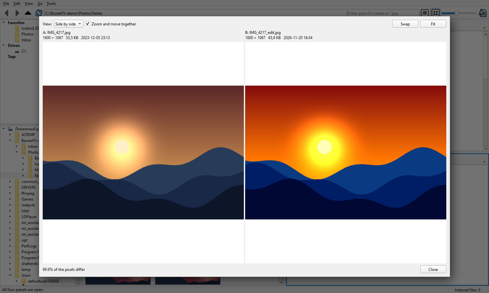
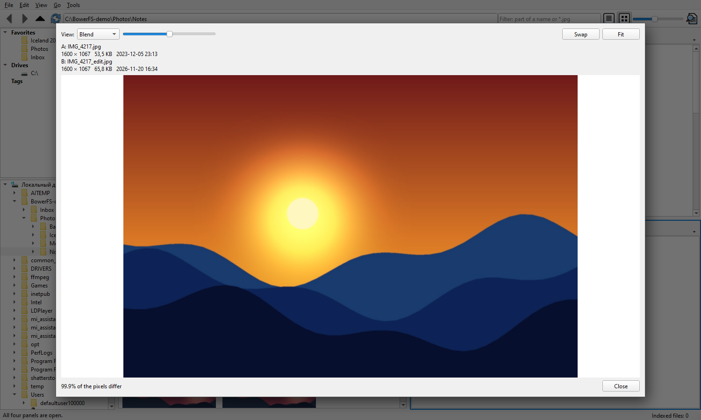
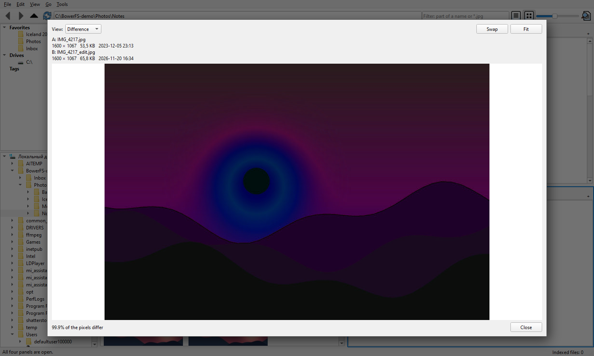
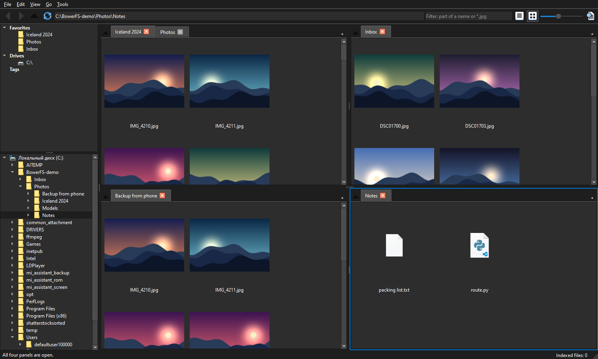

# BowerFS: all features

English · [Deutsch](FEATURES.de.md) · [Українська](FEATURES.uk.md) · [Back to the README](README.md)

This is the detailed description of everything BowerFS 0.1.0 can do, in the order you meet it in
the program. Keys are the defaults; every key can be changed in *Tools → Settings → Shortcuts*.

**Contents:**
[Window and navigation](#1-window-and-navigation) ·
[Views and selection](#2-views-and-selection) ·
[Preview](#3-preview) ·
[File operations](#4-file-operations) ·
[Batch rename](#5-batch-rename) ·
[Sort by rules](#6-sort-by-rules) ·
[Search](#7-search) ·
[Tags](#8-tags-and-favourites) ·
[Duplicates](#9-duplicates) ·
[Compare](#10-compare-two-files) ·
[Settings](#11-settings) ·
[Data and safety](#12-data-and-safety) ·
[Formats](#13-supported-formats) ·
[Not yet](#14-not-yet)

---

## 1. Window and navigation

### Panels and tabs
- The window holds **up to four panels**: two above and two below. *File → Open another panel*
  (Ctrl+Shift+N) opens the next free one on the current folder; **Tab** moves the focus to the next
  open panel. The active panel has a blue frame.
- Every panel has its **own tabs**. Ctrl+T opens a tab in the current folder, Ctrl+W closes it.
  Every tab can be closed; a panel without tabs disappears, and so does an empty row of panels.
  The very last tab of the window stays open.
- A tab shows **a folder or a list of results** (a search, or all files with one tag).
- The arrow at the left of the tab row goes **up one folder** (also Backspace).
- The window **remembers its session**: panels, tabs, folders, active panel, window size, splitter
  positions and whether the preview pane is open. It is restored at the next start.

### Address bar, history, favourites
- Type or paste a path into the **address bar** (Ctrl+L) and press Enter. Long paths (over 260
  characters) and Unicode names work.
- **Back / Forward** (Alt+←, Alt+→) walk through the history of the tab. **Refresh** is Ctrl+R; the
  list also refreshes itself when something changes in the folder.
- The sidebar has three groups above the folder tree: **Favourites** (Ctrl+B adds the current
  folder; right click removes it), **Drives** (with free and total space in the tip) and **Tags**.

### Folder tree
- A click opens the folder in the current tab. A **middle click**, or right click → *Open in new
  tab* / *Open in new panel*, opens it separately.

### Status line
- The bottom line shows the number of items, the number and total size of the selected ones, and on the right the
  number of **indexed files** (see [Duplicates](#9-duplicates)).

---

## 2. Views and selection

### List and thumbnails
- **List** (Ctrl+1) has the columns *Name, Size, Type, Modified, Date taken, Tags, Duplicate,
  Folder*. Click a header to sort; names are sorted naturally (`IMG_2` before `IMG_10`).
- **Thumbnails** (Ctrl+2) show pictures; the slider in the toolbar changes their size from 64 to
  384 pixels. Thumbnails exist for images, RAW, PSD/SVG/AI, 3D models, video, PDF and fonts. They are
  cached in one SQLite file, so a folder opens fast the second time.
- Over a **video** in the thumbnail view, moving the mouse left and right scrubs through a
  **storyboard** of frames (needs FFmpeg, see [Formats](#13-supported-formats)).
- *Date taken* and *Duplicate* are filled from the index, so they appear for folders that were part
  of a duplicate search.

### Filter, hidden files, selection
- **Filter the list** (Ctrl+F): type part of a name or a mask such as `*.jpg`; the list narrows as
  you type.
- **Show hidden files** (Ctrl+H) toggles hidden and system files.
- **Select all** (Ctrl+A), **Select by mask…** (Ctrl++, for example `*.jpg`) and **Invert
  selection** (Ctrl+*). Ranges work with Shift, single files with Ctrl.

---

## 3. Preview

Press **F3** or **Ctrl+Q**, or click the preview button, to open the pane on the right. It follows
the current file. If a file cannot be shown, the pane says why instead of failing.

| Type | What you get |
|---|---|
| Images (JPG, PNG, WebP, GIF, TIFF, BMP, HEIC, ICO) | zoom with the wheel, pan by dragging, double click toggles fit / 100 % |
| RAW (CR2, CR3, NEF, ARW, DNG, RAF, ORF and more) | the picture decoded from the file |
| PSD / PSB, SVG, AI | PSD as a flattened picture, SVG rendered, AI when it contains a PDF part |
| Video (MP4, MOV, MKV, AVI, WebM and more) | a player with play button, position slider, clock and volume |
| Audio (MP3, WAV, FLAC, OGG, M4A and more) | the same player |
| PDF | the pages one below another, fitted to the width |
| DOCX, XLSX | text and tables (not the full page layout) |
| Text and code (TXT, MD, JSON, CSV, PY, JS, HTML, CSS, SQL and many more) | colour highlighting for the language |
| Archives (ZIP, 7z) | the list of files inside, without unpacking |
| Fonts (TTF, OTF) | a text sample |
| 3D models (STL, OBJ, PLY, GLB, glTF) | rotate with the left button, move with the right, zoom with the wheel; the *Up* button switches the axis if a model lies on its side; model facts (vertices, triangles, size) |
| Anything else | metadata, size and the first bytes as a hex dump |

---

## 4. File operations

All operations share the same rules, so nothing is lost by accident.

### Copy, move, create, delete
- **Copy** (F5) and **Move** (F6) ask for the destination: one of the **other open panels**, or any
  folder of the tree, or a path you type.
- **Drag and drop** between panels, and to or from Windows Explorer. On the same drive a drag
  moves, to another drive it copies; hold **Ctrl** to copy, **Shift** to move.
- **New folder** (F7), **New file** (Shift+F4), **Rename** (F2).
- **Delete** (F8 or Del) sends files to the **Recycle Bin**. **Shift+Del** deletes permanently,
  after a confirmation.
- On a **drive without a Recycle Bin** (network, USB stick) deleting is permanent, so BowerFS lists
  the files and asks **twice**. The second question has *Ask only once* (also in Settings).

### Plan, preview and conflicts
- Before copy, move, delete and sorting, a **list of operations** is shown. **Untick any line** to
  leave that file out.
- If a target already exists you choose what happens: *do not touch it and report it* (default),
  *skip the file*, or *keep both* (a number is added to the new name). **Nothing is ever
  overwritten.**

### Safety guarantees
- A copy is first written under a temporary name and renamed only when it is complete.
- A **move between drives** is copy → verification by SHA-256 → removal of the source. If the check
  fails, the source stays.
- One failing file does not stop the others; it is reported at the end.
- Every operation has **progress and a Cancel button**, and runs in the background, so the window
  stays usable.

### Journal and undo
- Every operation is written to the **journal** (Ctrl+J): date, kind, description, number of items,
  status, and per file the source, the target and the result.
- **Undo** (Ctrl+Z) takes back the last operation. In the journal you can undo **any** earlier
  operation. Moves, renames, copies (the copies go to the Recycle Bin) and deletions to the Recycle Bin
  can be undone; a permanent deletion cannot, and the journal says so.

---

## 5. Batch rename

Select files and press **Ctrl+M**.

- Write a **template**; the table shows the new name of every file, and lines with problems
  (existing names, characters Windows does not allow) are marked. Untick files to skip them.
- Fields: `{name}` the old name, `{ext}` the extension, `{counter}` a number (`{counter:3}` with 3
  digits; start and number of digits can also be set below), `{date}` the modification date
  (`{date:%Y%m%d}` for another format), `{time}`, `{parent}` the name of the folder.
- Other text stays as written, braces are dropped: `{date}_{counter}_food` works. The extension is
  kept unless you use `{ext}`. Doubled separators are cleaned up.
- Example: `{date:%Y-%m-%d}_Iceland_{counter:3}` gives `2026-11-20_Iceland_001.jpg`.

---

## 6. Sort by rules

*Tools → Sort by rules…* (Ctrl+Shift+R) moves or copies files into folders by rules, for example
"all PSD files of 2025 go to `D:\Archive\PSD\2025`".

- A rule has a **name**, **conditions** and an **action**. Conditions (all must hold): extensions
  (`psd, psb`), type (images, RAW, video…), year of the modification date, part of the name.
- The action is *Move* or *Copy* **to a folder**, with an optional **subfolder template** such as
  `{year}/{month}` (fields: `{year}`, `{month}`, `{ext}`, `{kind}`).
- Apply to the **selected files**, the **files of the current folder**, or the **folder with its
  subfolders**.
- Rules are **saved** (New, Save, Delete). *Preview…* builds the plan, which then goes through the
  usual list of operations, journal and undo.

---

## 7. Search

*Tools → Search…* (Alt+F7) looks in the current folder and its subfolders, on disk, with no index
needed.

- **Name**: a part of the name, or a mask with `*` and `?` such as `IMG_20*.jpg`.
- **Type**: images, RAW, design files, 3D, video, audio, PDF, documents, archives, fonts, text.
- **Size** from / to in MB, **modified** from / to, **tag**.
- The result opens in **its own tab**, where all the usual commands work (copy, tags, preview…).

---

## 8. Tags and favourites

- **Tags** (Ctrl+G): create tags with a name and a colour, and tick them for the selected files; a
  half-ticked box means "some of the selected files have it". Several files at once.
- Tags are stored in the BowerFS database; **your files are not changed**.
- The **Tags** group of the sidebar lists tags with the number of files; a click opens all files
  with that tag as a result tab. Tags also show in the *Tags* column and in search.
- **Favourites** are folders you pin with Ctrl+B.

---

## 9. Duplicates

*Tools → Find duplicates…* (Ctrl+D) compares files **by content**, not by name.

1. **Choose folders** (the current and the other panel's folder are offered; add or remove any).
   Subfolders are included.
2. The program indexes the files and compares them in three steps: **size**, then a **quick hash**
   (first and last part of the file), then the **full SHA-256** only for candidates. Only
   byte-identical files are reported. You can pause and cancel; hashes are reused if size and date
   did not change.
3. The result shows **groups**, the biggest waste first, with a strip of previews, size, folder, date
   and dimensions for each file.
4. In each group one file is marked as the **best copy** (★). The rule, in order: larger resolution;
   original format (RAW, then lossless such as PNG, TIFF, PSD, DNG, then lossy); a known shooting
   date and the earlier one; earlier modification date; longer video; a name without “copy” or
   “(1)”; a shorter path.
5. Change the choice with **Keep this one**; **Tick all but the best** and **Untick all** help with
   many groups. **Move ticked to Recycle Bin** sends them there, with a journal entry, so it can be
   undone.

The scan fills the **index**: after it the list shows *Date taken* and *Duplicate* for those
folders, and the status line counts the indexed files.

---

## 10. Compare two files

Select two files in one panel, or one file in each of two panels, and press **F9**.

- **Side by side**: two views that **zoom and move together** (switch off with the check box).
- **Blend**: the second picture over the first; a **slider** sets how much of it shows.
- **Difference**: every changed pixel lights up, and the footer says how many percent of the pixels
  differ.
- **Flip**: shows one picture and switches to the other with **Space**, to spot small changes.
- **Swap** exchanges the two files, **Fit** fits both to the window.
- Each file's name, dimensions, size and date are shown above the pictures. If the files are not
  pictures (for example two PDFs or two texts), their previews are shown side by side.

---

## 11. Settings

*Tools → Settings…* (Ctrl+,)

- **Language**: English, Deutsch, Українська; switches **without a restart**. On first start the
  Windows language is used (English if it is not available).
- **Theme**: light or dark.
- **Date format** and **number format** are set separately from the language.
- **Ask only once** when deleting from a drive without a Recycle Bin.
- **Data folder**: where the database, thumbnail cache and logs live; *Move…* copies them to a new
  place.
- **Thumbnails**: shows the cache size and clears it on command.
- **Shortcuts**: every command, with *Reset shortcuts to defaults*.

---

## 12. Data and safety

- **Fully offline**: BowerFS makes no network connections, has no telemetry, no account and no
  automatic updates.
- **Portable**: unpack and run; nothing is written to the registry. The data folder is chosen on
  first start (default `Documents\BowerFS`) and can be moved. The choice is stored in
  `location.json` next to the program, or in `%APPDATA%\BowerFS` if the program folder is
  read-only.
- The data folder holds `bowerfs.db` (index, tags, rules, journal, settings), `thumbs.db` (thumbnail
  cache) and `logs\bowerfs.log` (rotated by size).
- Your files change **only through operations you confirm**, and each is journaled.
- **If it says “Access denied”** on a file that is not read-only, security software (Windows
  “Controlled folder access”, or an antivirus ransomware shield such as AVG) is blocking the
  unsigned `BowerFS.exe`: add it to the allowed programs. `BowerFS.exe --selftest <folder with
  pictures>` checks every format and file operation and writes `data\selftest.txt`.

---

## 13. Supported formats

| Kind | Extensions |
|---|---|
| Images | jpg, jpeg, png, webp, gif, tif, tiff, bmp, heic, heif, avif, ico |
| RAW | cr2, cr3, nef, nrw, arw, srf, sr2, dng, raf, orf, rw2, pef, srw, x3f, erf, kdc, mrw, 3fr, iiq |
| Design | psd, psb, svg, ai |
| 3D models | stl, obj, ply, glb, gltf |
| Video | mp4, m4v, mov, avi, mkv, webm, wmv, flv, mpg, mpeg, mts, m2ts, 3gp, ogv |
| Audio | mp3, wav, flac, ogg, m4a, aac, wma, opus, aiff |
| Documents | pdf, docx, xlsx |
| Archives | zip, 7z |
| Fonts | ttf, otf |
| Text and code | txt, md, log, csv, json, xml, yaml, ini, toml, py, js, ts, html, css, c, cpp, cs, java, go, rs, sql, sh, bat, ps1 and more |

**Optional tools.** Video thumbnails, the storyboard and video metadata need `ffmpeg.exe` and
`ffprobe.exe`. They are not included; put them into the `tools` folder next to `BowerFS.exe`
(otherwise BowerFS looks for them in PATH).

---

## 14. Not yet

Planned for the next versions: similar-image search, smart folders, ratings, Live Photo pairs, EXIF
editing, format conversion, video tools (frames, trimming, re-encoding), Android through ADB,
backups with integrity checks.
