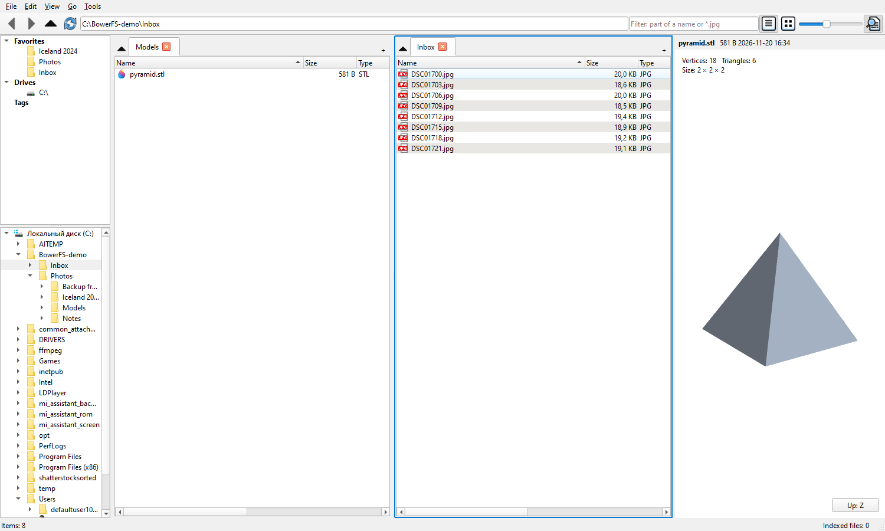
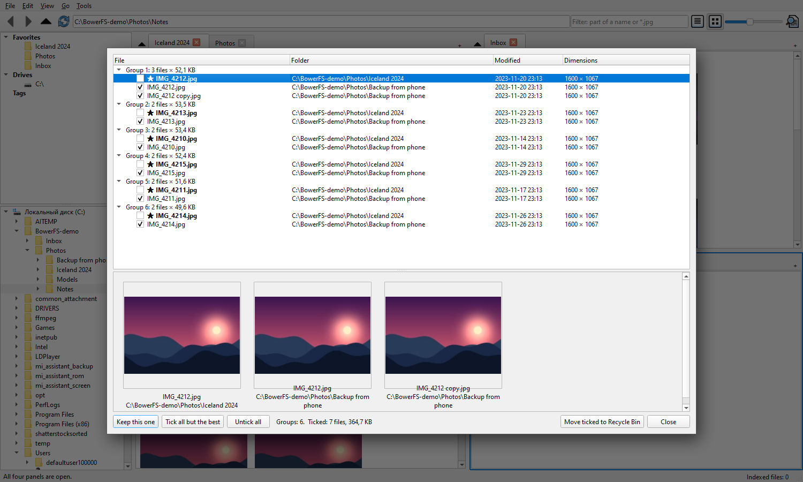
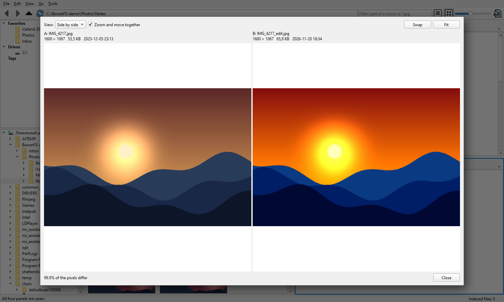
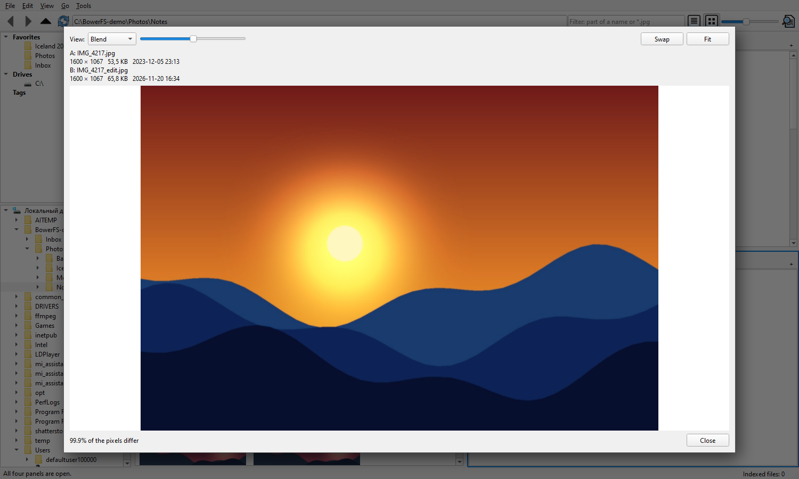

# BowerFS: усі можливості

[English](FEATURES.md) · [Deutsch](FEATURES.de.md) · **Українська** · [Назад до README](README.uk.md)

Це докладний опис усього, що вміє BowerFS 0.1.0, у тому порядку, у якому ви зустрічаєте це в
програмі. Клавіші типові; кожну можна змінити в *Інструменти → Налаштування → Гарячі клавіші*.

**Зміст:**
[Вікно й навігація](#1-вікно-й-навігація) ·
[Вигляд і виділення](#2-вигляд-і-виділення) ·
[Перегляд](#3-перегляд) ·
[Файлові операції](#4-файлові-операції) ·
[Пакетне перейменування](#5-пакетне-перейменування) ·
[Сортування за правилами](#6-сортування-за-правилами) ·
[Пошук](#7-пошук) ·
[Теги](#8-теги-і-вибране) ·
[Дублікати](#9-дублікати) ·
[Порівняння](#10-порівняння-двох-файлів) ·
[Налаштування](#11-налаштування) ·
[Дані й безпека](#12-дані-й-безпека) ·
[Формати](#13-підтримувані-формати) ·
[Поки що немає](#14-поки-що-немає)

---

## 1. Вікно й навігація

### Панелі та вкладки
- У вікні **до чотирьох панелей**: дві зверху й дві знизу. *Файл → Відкрити ще одну панель*
  (Ctrl+Shift+N) відкриває наступну вільну на поточній теці; **Tab** переносить фокус на наступну
  відкриту панель. Активна панель має синю рамку.
- Кожна панель має **власні вкладки**. Ctrl+T відкриває вкладку в поточній теці, Ctrl+W закриває її.
  Закрити можна будь-яку вкладку; панель без вкладок зникає, так само порожній ряд панелей.
  Остання вкладка вікна лишається.
- Вкладка показує **теку або список результатів** (пошуку чи всіх файлів з одним тегом).
- Стрілка ліворуч від вкладок веде **на одну теку вгору** (також Backspace).
- Програма **пам’ятає сеанс**: панелі, вкладки, теки, активну панель, розмір вікна, положення
  роздільників і те, чи відкрито панель перегляду. Усе відновлюється під час наступного запуску.

### Адресний рядок, історія, вибране
- Уведіть або вставте шлях в **адресний рядок** (Ctrl+L) і натисніть Enter. Довгі шляхи (понад 260
  символів) та імена в Юнікоді працюють.
- **Назад / Уперед** (Alt+←, Alt+→) ідуть історією вкладки. **Оновити** — Ctrl+R; список також
  оновлюється сам, коли в теці щось змінюється.
- Бічна панель має над деревом тек три групи: **Вибране** (Ctrl+B додає поточну теку; правий клік
  вилучає її), **Диски** (з вільним і загальним місцем у підказці) та **Теги**.

### Дерево тек
- Клацання відкриває теку в поточній вкладці. **Середня кнопка миші** або правий клік → *Відкрити в
  новій вкладці* / *Відкрити в новій панелі* відкриває її окремо.

### Рядок стану
- Нижній рядок показує кількість елементів, кількість і загальний розмір виділених, а праворуч —
  кількість **проіндексованих файлів** (див. [Дублікати](#9-дублікати)).

---

## 2. Вигляд і виділення

### Список і мініатюри
- **Список** (Ctrl+1) має стовпці *Ім’я, Розмір, Тип, Змінено, Дата зйомки, Теги, Дублікат, Папка*.
  Клацання заголовка сортує; імена сортуються природно (`IMG_2` перед `IMG_10`).
- **Мініатюри** (Ctrl+2) показують зображення; повзунок на панелі інструментів змінює їхній розмір
  від 64 до 384 пікселів. Мініатюри є для зображень, RAW, PSD/SVG/AI, 3D-моделей, відео, PDF і
  шрифтів. Вони лежать в одному файлі SQLite, тому тека вдруге відкривається швидко.
- Якщо в режимі мініатюр водити мишею над **відео**, перегортається **розкадровка** (потрібен FFmpeg,
  див. [Формати](#13-підтримувані-формати)).
- *Дата зйомки* та *Дублікат* беруться з індексу, тому з’являються для тек, що брали участь у
  пошуку дублікатів.

### Фільтр, приховані файли, виділення
- **Фільтр списку** (Ctrl+F): уведіть частину імені або маску на кшталт `*.jpg`; список звужується
  під час набору.
- **Показувати приховані файли** (Ctrl+H) вмикає або вимикає приховані й системні файли.
- **Виділити все** (Ctrl+A), **Виділити за маскою…** (Ctrl++, наприклад `*.jpg`) та **Інвертувати
  виділення** (Ctrl+*). Діапазони — з Shift, окремі файли — з Ctrl.

---

## 3. Перегляд

Натисніть **F3** або **Ctrl+Q**, або кнопку перегляду, щоб відкрити панель праворуч. Вона слідує за
поточним файлом. Якщо файл не вдається показати, панель називає причину.

| Тип | Що ви отримуєте |
|---|---|
| Зображення (JPG, PNG, WebP, GIF, TIFF, BMP, HEIC, ICO) | масштаб колесом, переміщення перетягуванням, подвійне клацання перемикає «вписати» / 100 % |
| RAW (CR2, CR3, NEF, ARW, DNG, RAF, ORF та інші) | зображення, декодоване з файлу |
| PSD / PSB, SVG, AI | PSD як плоске зображення, SVG відмальований, AI — якщо містить PDF-частину |
| Відео (MP4, MOV, MKV, AVI, WebM та інші) | плеєр із кнопкою відтворення, повзунком позиції, годинником і гучністю |
| Аудіо (MP3, WAV, FLAC, OGG, M4A та інші) | той самий плеєр |
| PDF | сторінки одна під одною, за шириною |
| DOCX, XLSX | текст і таблиці (не повна верстка сторінки) |
| Текст і код (TXT, MD, JSON, CSV, PY, JS, HTML, CSS, SQL та багато інших) | підсвічування кольором для мови |
| Архіви (ZIP, 7z) | список файлів усередині, без розпакування |
| Шрифти (TTF, OTF) | зразок тексту |
| 3D-моделі (STL, OBJ, PLY, GLB, glTF) | обертання лівою кнопкою, переміщення правою, масштаб колесом; кнопка *Up* перемикає вісь, якщо модель лежить на боці; відомості про модель (вершини, трикутники, розмір) |
| Усе інше | метадані, розмір і перші байти як шістнадцятковий дамп |

---

## 4. Файлові операції

Усі операції дотримуються одних правил, щоб нічого не губилося випадково.

### Копіювання, переміщення, створення, видалення
- **Копіювання** (F5) і **переміщення** (F6) питають, куди: одна з **інших відкритих панелей**,
  будь-яка тека з дерева або шлях, який ви введете.
- **Перетягування** між панелями та до/з Провідника Windows. На тому самому диску перетягування
  переміщує, на інший — копіює; з **Ctrl** копіює, з **Shift** переміщує.
- **Нова тека** (F7), **Новий файл** (Shift+F4), **Перейменувати** (F2).
- **Видалення** (F8 або Del) відправляє файли до **Кошика**. **Shift+Del** видаляє остаточно, після
  підтвердження.
- На **диску без Кошика** (мережевому, змінному) видалення остаточне, тому BowerFS показує файли й
  питає **двічі**. Друге запитання має пункт *Питати лише один раз* (також у Налаштуваннях).

### План, перегляд і конфлікти
- Перед копіюванням, переміщенням, видаленням і сортуванням показується **список операцій**. **Зніміть
  позначку з рядка**, щоб пропустити файл.
- Якщо ціль уже існує, ви обираєте: *Не чіпати й повідомити* (типово), *Пропустити файл* або
  *Залишити обидва* (до нового імені додається номер). **Нічого ніколи не перезаписується.**

### Гарантії безпеки
- Копія спершу пишеться під тимчасовим іменем і перейменовується, лише коли готова повністю.
- **Переміщення між дисками** — це копіювання → перевірка SHA-256 → видалення джерела. Якщо перевірка
  не пройшла, джерело лишається.
- Один файл із помилкою не зупиняє решту; про нього повідомляється наприкінці.
- Кожна операція має **прогрес і кнопку «Скасувати»** та працює у фоні, тож вікно лишається
  придатним до роботи.

### Журнал і скасування
- Кожна операція записується до **журналу** (Ctrl+J): дата, вид, опис, кількість елементів, стан,
  а для кожного файлу — джерело, ціль і результат.
- **Скасувати** (Ctrl+Z) відкочує останню операцію. У журналі можна скасувати **будь-яку** попередню.
  Переміщення, перейменування, копіювання (копії йдуть до Кошика) та видалення до Кошика можна
  скасувати; остаточне видалення — ні, і журнал про це каже.

---

## 5. Пакетне перейменування

Виділіть файли й натисніть **Ctrl+M**.

- Напишіть **шаблон**; таблиця показує нове ім’я кожного файлу, а рядки з проблемами (наявні
  імена, символи, заборонені в Windows) позначені. Знімайте позначки, щоб пропустити файли.
- Поля: `{name}` старе ім’я, `{ext}` розширення, `{counter}` номер (`{counter:3}` — три цифри;
  початок і кількість цифр можна задати й нижче), `{date}` дата зміни (`{date:%Y%m%d}` — інший
  формат), `{time}`, `{parent}` ім’я теки.
- Решта тексту лишається як є, фігурні дужки прибираються: `{date}_{counter}_food` працює.
  Розширення зберігається, якщо не використано `{ext}`. Подвоєні роздільники прибираються.
- Приклад: `{date:%Y-%m-%d}_Iceland_{counter:3}` дає `2026-11-20_Iceland_001.jpg`.

---

## 6. Сортування за правилами

*Інструменти → Сортування за правилами…* (Ctrl+Shift+R) переміщує або копіює файли в теки за
правилами, наприклад «усі PSD за 2025 рік — до `D:\Archive\PSD\2025`».

- Правило має **назву**, **умови** й **дію**. Умови (мають виконуватися всі): розширення
  (`psd, psb`), тип (зображення, RAW, відео…), рік дати зміни, частина імені.
- Дія — *Перемістити* або *Копіювати* **до теки**, із необов’язковим **шаблоном підтеки** на кшталт
  `{year}/{month}` (поля: `{year}`, `{month}`, `{ext}`, `{kind}`).
- Застосувати до **виділених файлів**, **файлів поточної теки** або **теки з підтеками**.
- Правила **зберігаються** (Нове, Зберегти, Видалити). *Попередній перегляд…* будує план, який далі
  проходить звичний список операцій, журнал і скасування.

---

## 7. Пошук

*Інструменти → Пошук…* (Alt+F7) шукає в поточній теці та її підтеках, прямо на диску, без індексу.

- **Ім’я**: частина імені або маска з `*` і `?`, наприклад `IMG_20*.jpg`.
- **Тип**: зображення, RAW, файли дизайну, 3D, відео, аудіо, PDF, документи, архіви, шрифти, текст.
- **Розмір** від / до в МБ, **змінено** від / до, **тег**.
- Результат відкривається **у власній вкладці**, де працюють усі звичні команди (копіювання, теги,
  перегляд…).

---

## 8. Теги і вибране

- **Теги** (Ctrl+G): створюйте теги з іменем і кольором та позначайте їх для виділених файлів;
  наполовину позначене поле означає «деякі з виділених файлів його мають». Одразу для кількох файлів.
- Теги зберігаються в базі BowerFS; **ваші файли не змінюються**.
- Група **Теги** бічної панелі показує теги з кількістю файлів; клацання відкриває всі файли з цим
  тегом як вкладку результатів. Теги видно також у стовпці *Теги* та в пошуку.
- **Вибране** — теки, які ви закріплюєте через Ctrl+B.

---

## 9. Дублікати

*Інструменти → Знайти дублікати…* (Ctrl+D) порівнює файли **за вмістом**, а не за іменем.

1. **Оберіть теки** (пропонуються поточна й тека іншої панелі; можна додати чи вилучити будь-які).
   Підтеки включено.
2. Програма індексує файли й порівнює їх у три кроки: **розмір**, потім **швидкий хеш** (початок і
   кінець файлу), потім **повний SHA-256** лише для кандидатів. Повідомляються тільки побайтно
   однакові файли. Можна призупинити й скасувати; хеші використовуються повторно, якщо розмір і дата
   не змінилися.
3. Результат показує **групи**, найбільші втрати першими, зі смугою мініатюр та розміром, текою,
   датою й розмірами зображення кожного файлу.
4. У кожній групі один файл позначено **найкращою копією** (★). Правило, у такому порядку: більша
   роздільність; вихідний формат (RAW, потім без втрат, як PNG, TIFF, PSD, DNG, потім із втратами);
   відома та раніша дата зйомки; раніша дата зміни; довше відео; ім’я без «copy» чи «(1)»;
   коротший шлях.
5. Змініть вибір кнопкою **Залишити цей**; **Позначити всі, крім найкращих** і **Зняти всі позначки**
   допомагають, коли груп багато. **Позначені — до кошика** відправляє їх туди, із записом у
   журналі, тож це можна скасувати.

Пошук наповнює **індекс**: після нього список показує *Дату зйомки* та *Дублікат* для цих тек, а
рядок стану рахує проіндексовані файли.

---

## 10. Порівняння двох файлів

Виділіть два файли в одній панелі або по одному в двох панелях і натисніть **F9**.

- **Поруч**: два вигляди, що **масштабуються й рухаються разом** (вимикається прапорцем).
- **Накладання**: друге зображення поверх першого; **повзунок** задає, наскільки воно видно.
- **Різниця**: кожен змінений піксель світиться, а внизу сказано, скільки відсотків пікселів
  відрізняється.
- **Перемикання**: показує одне зображення й перемикається на інше **пробілом**, щоб помітити
  дрібні зміни.
- **Поміняти** міняє два файли місцями, **Вписати** вписує обидва у вікно.
- Ім’я, розміри, розмір і дата кожного файлу показані над зображеннями. Якщо файли — не зображення
  (наприклад, два PDF чи два тексти), їхній перегляд показується поруч.

---

## 11. Налаштування

*Інструменти → Налаштування…* (Ctrl+,)

- **Мова**: English, Deutsch, Українська; перемикається **без перезапуску**. Під час першого запуску
  береться мова Windows (інакше англійська).
- **Тема**: світла або темна.
- **Формат дати** і **формат чисел** задаються окремо від мови.
- **Питати лише один раз** під час видалення з диска без Кошика.
- **Папка даних**: де лежать база, кеш мініатюр і журнали роботи; *Перенести…* копіює їх на нове
  місце.
- **Мініатюри**: показує розмір кешу й очищає його за командою.
- **Гарячі клавіші**: кожна команда, із кнопкою *Повернути гарячі клавіші за замовчуванням*.

---

## 12. Дані й безпека

- **Повністю офлайн**: BowerFS не робить мережевих з’єднань, не має телеметрії, облікового запису й
  автоматичних оновлень.
- **Портативна**: розпакуйте й запустіть; у реєстр нічого не пишеться. Теку даних обирають під час
  першого запуску (типово `Документи\BowerFS`), її можна перенести. Вибір зберігається в
  `location.json` поруч із програмою або в `%APPDATA%\BowerFS`, якщо тека програми лише для читання.
- У теці даних лежать `bowerfs.db` (індекс, теги, правила, журнал, налаштування), `thumbs.db` (кеш
  мініатюр) і `logs\bowerfs.log` (ротація за розміром).
- Ваші файли змінюються **лише операціями, які ви підтвердили**, і кожну записано в журнал.
- **Якщо пише «Немає доступу»** для файлу, який не лише для читання, непідписану `BowerFS.exe`
  блокує захисне ПЗ («Контрольований доступ до тек» Windows або захист від програм-вимагачів в
  антивірусі, як-от AVG): додайте її до дозволених програм. `BowerFS.exe --selftest <тека із
  зображеннями>` перевіряє всі формати й файлові операції та пише `data\selftest.txt`.

---

## 13. Підтримувані формати

| Вид | Розширення |
|---|---|
| Зображення | jpg, jpeg, png, webp, gif, tif, tiff, bmp, heic, heif, avif, ico |
| RAW | cr2, cr3, nef, nrw, arw, srf, sr2, dng, raf, orf, rw2, pef, srw, x3f, erf, kdc, mrw, 3fr, iiq |
| Дизайн | psd, psb, svg, ai |
| 3D-моделі | stl, obj, ply, glb, gltf |
| Відео | mp4, m4v, mov, avi, mkv, webm, wmv, flv, mpg, mpeg, mts, m2ts, 3gp, ogv |
| Аудіо | mp3, wav, flac, ogg, m4a, aac, wma, opus, aiff |
| Документи | pdf, docx, xlsx |
| Архіви | zip, 7z |
| Шрифти | ttf, otf |
| Текст і код | txt, md, log, csv, json, xml, yaml, ini, toml, py, js, ts, html, css, c, cpp, cs, java, go, rs, sql, sh, bat, ps1 та інші |

**Додаткові інструменти.** Мініатюри відео, розкадровка й метадані відео потребують `ffmpeg.exe` і
`ffprobe.exe`. У збірку вони не входять; покладіть їх у теку `tools` поруч із `BowerFS.exe`
(інакше BowerFS шукає їх у PATH).

---

## 14. Поки що немає

Заплановано для наступних версій: пошук схожих зображень, розумні теки, оцінки, пари Live Photo,
редагування EXIF, перетворення форматів, відеоінструменти (кадри, обрізання, перекодування),
Android через ADB, резервні копії з перевіркою цілісності.
