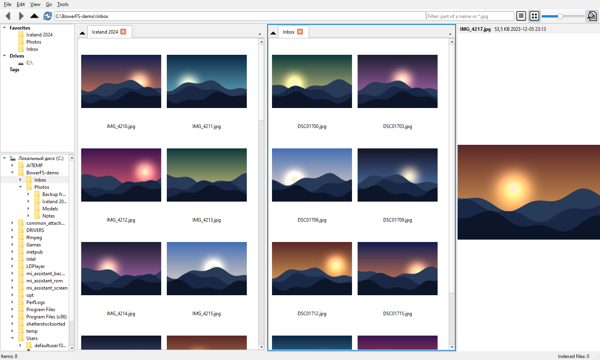
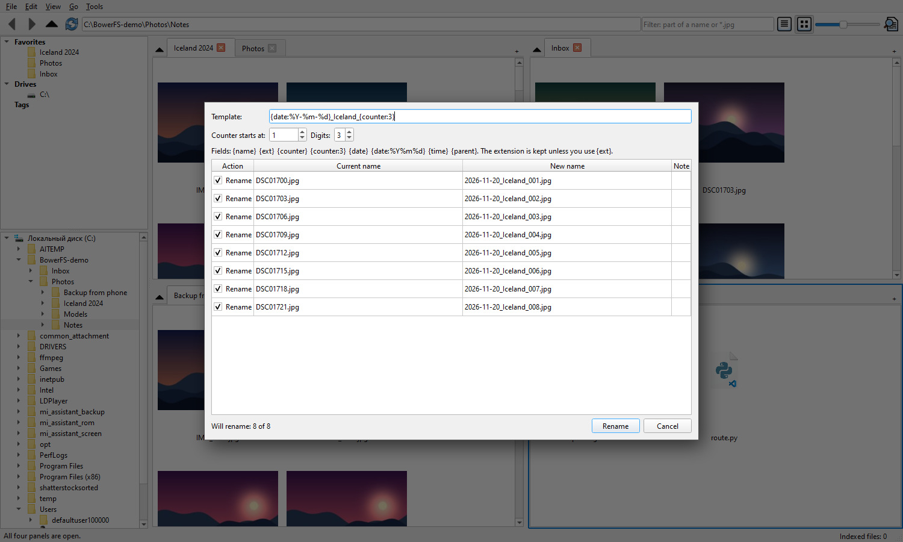

# BowerFS


[English](README.md) · **Deutsch** · [Українська](README.uk.md)

Ein Windows-Dateimanager für große Foto- und Videobibliotheken: bis zu vier Fenster mit Tabs, Vorschau für fast jede Datei, Duplikate nach Inhalt und ein Protokoll aller Vorgänge mit Rückgängig. Vollständig offline: kein Internet, keine Telemetrie, kein Konto.



## Über das Programm

- **Bis zu vier Fenster** (zwei oben, zwei unten) mit eigenen Tabs; Ordnerbaum, Favoriten und Tags.
- **Vorschau für fast alles.** Bilder (JPG, PNG, WebP, GIF, TIFF, BMP, HEIC, RAW, PSD, SVG), Video, Audio, PDF, DOCX, XLSX, Text und Code, Archive (ZIP, 7z), Schriften und 3D-Modelle (STL, OBJ, PLY, GLB, glTF).
- **Duplikate nach Inhalt.** Größe, dann ein Schnell-Hash, dann volles SHA-256; die beste Kopie jeder Gruppe wird markiert, der Rest geht in den Papierkorb.
- **Zwei Dateien vergleichen:** nebeneinander, überblendet, als Differenzbild oder im Wechsel.
- **Sichere Vorgänge.** Kopieren, Verschieben, Umbenennen und Stapel-Umbenennung zeigen zuerst einen Plan, landen im Protokoll und lassen sich rückgängig machen (Strg+Z). Auf Laufwerken ohne Papierkorb (Netzwerk, USB) fragt das Programm vor dem endgültigen Löschen zweimal.
- **Stapel-Umbenennung per Vorlage**, z. B. `{date:%Y-%m-%d}_Island_{counter:3}`, mit Vorschau jedes neuen Namens.
- **Drag and drop** zwischen Fenstern und zum bzw. vom Windows-Explorer.
- **Oberfläche** auf Englisch, Deutsch und Ukrainisch, helles und dunkles Design, anpassbare Tastenkürzel.

**Idee:** Mariia Mashura  
**Technische Umsetzung:** Claude (Anthropic)

## Screenshots

<table>
<tr>
<td width="50%"><br><sub><b>Vier Fenster</b>, jedes mit eigenen Tabs</sub></td>
<td width="50%"><br><sub><b>Duplikate</b> nach Inhalt, beste Kopie markiert</sub></td>
</tr>
<tr>
<td><br><sub><b>Vergleich</b> zweier Bilder: Differenzbild</sub></td>
<td><br><sub><b>Stapel-Umbenennung</b> mit Live-Vorschau</sub></td>
</tr>
<tr>
<td><br><sub><b>3D-Modelle</b> in der Vorschau</sub></td>
<td><br><sub><b>Dunkles Design</b></sub></td>
</tr>
</table>

## Download

Laden Sie `BowerFS-<Version>-win64.zip` von der Seite **Releases** dieses Repositorys, entpacken Sie
es in einen beliebigen Ordner (auch ein USB-Stick geht) und starten Sie `BowerFS.exe`. Es gibt
keinen Installer und es wird nichts in die Registry geschrieben. Windows 10 und 11, 64 Bit.

Download prüfen: Die SHA-256-Summe des Archivs steht in `SHA256SUMS.txt`.

```powershell
Get-FileHash BowerFS-<Version>-win64.zip -Algorithm SHA256
```

## Erster Start

1. Das Programm fragt, wo es seine Daten ablegen soll (Datenbank, Miniaturbild-Cache, Logs).
   Standard ist `Dokumente\BowerFS`. Später lässt sich der Ordner unter *Extras → Einstellungen*
   verschieben.
2. Windows SmartScreen meldet evtl. eine unbekannte App, weil das Programm nicht signiert ist:
   *Weitere Informationen → Trotzdem ausführen*.
3. Lässt sich eine Datei nicht umbenennen oder löschen („Zugriff verweigert“), obwohl sie nicht
   schreibgeschützt ist, blockiert ein Antivirenprogramm (z. B. AVG) oder der „Überwachte
   Ordnerzugriff“ von Windows das unbekannte Programm. Fügen Sie `BowerFS.exe` zu den erlaubten
   Programmen hinzu.


## Tastenkürzel

F3 Vorschau, F5 kopieren, F6 verschieben, F2 umbenennen, Strg+M Stapel-Umbenennung,
F8 / Entf in den Papierkorb, F9 vergleichen, Strg+D Duplikate, Strg+Z rückgängig,
Strg+T / Strg+W neuer / schließen Tab, Strg+Umschalt+N weiteres Fenster, Tab nächstes Fenster,
F1 Info. Alle lassen sich in den Einstellungen ändern.

## Optionale Werkzeuge

Legen Sie `ffmpeg.exe` und `ffprobe.exe` in den Ordner `tools` neben `BowerFS.exe`, für
Videominiaturen und Bildfolgen (sonst Suche im PATH). Sie sind nicht enthalten.

## Datenschutz

BowerFS baut keine Netzwerkverbindungen auf. Ihre Dateien werden nur durch Vorgänge verändert, die
Sie bestätigen. Tags und Index liegen im gewählten Datenordner.

## Lizenz

Siehe [LICENSE.txt](LICENSE.txt) und [THIRD_PARTY_NOTICES.md](THIRD_PARTY_NOTICES.md).
Der Quellcode liegt in einem privaten Repository.

## Probleme und Wünsche

Eröffnen Sie ein Issue auf dieser Seite. Bitte keine privaten Fotos anhängen und die Logdatei
`logs\bowerfs.log` im Datenordner vor dem Anhängen prüfen.
