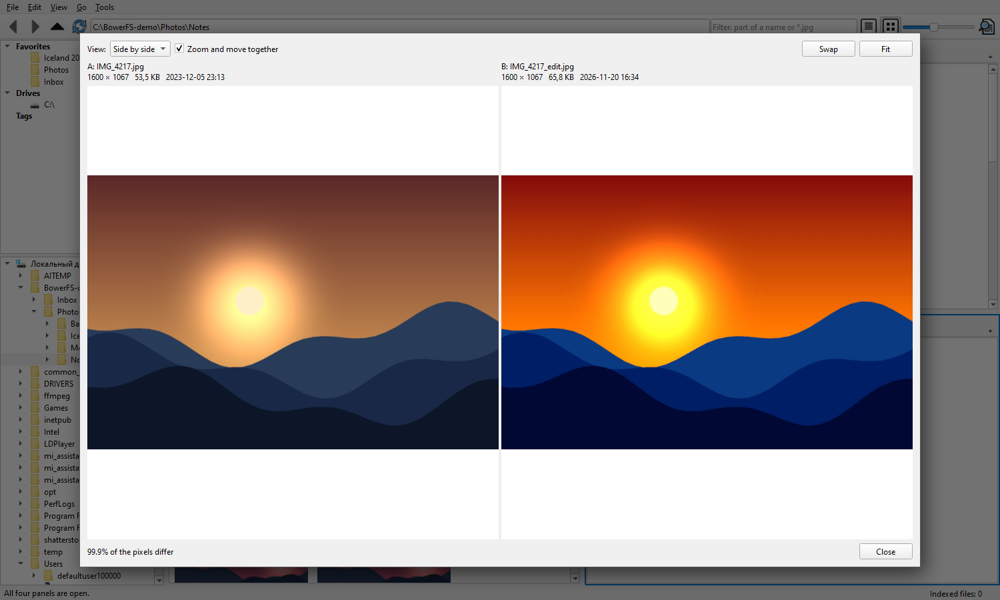
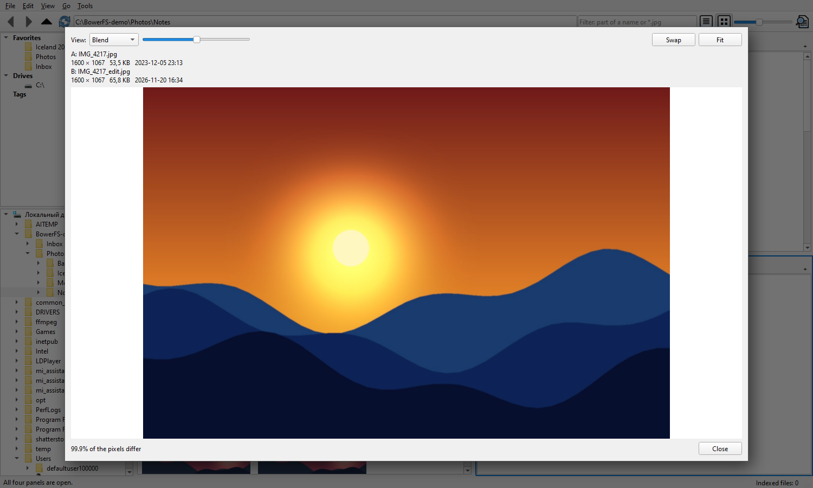

# BowerFS


**English** · [Deutsch](README.de.md) · [Українська](README.uk.md)

A Windows file manager for large libraries of photos and video: up to four panels with tabs, a preview for almost every file, duplicates found by content, and every operation written to a journal you can undo. Fully offline: no internet, no telemetry, no account.


## About

- **Up to four panels** (two above, two below), each with its own tabs; folder tree, favourites and tags.
- **Preview of almost everything.** Images (JPG, PNG, WebP, GIF, TIFF, BMP, HEIC, RAW, PSD, SVG), video, audio, PDF, DOCX, XLSX, text and code, archives (ZIP, 7z), fonts and 3D models (STL, OBJ, PLY, GLB, glTF).
- **Duplicates by content.** Size, then a quick hash, then full SHA-256; the best copy of each group is marked, the rest go to the Recycle Bin.
- **Compare two files** side by side, blended, as a difference map, or flipping between them.
- **Safe operations.** Copy, move, rename and batch rename show a plan first, are written to a journal and can be undone (Ctrl+Z). On drives without a Recycle Bin (network, USB) the program asks twice before a permanent deletion.
- **Batch rename by template**, for example `{date:%Y-%m-%d}_Iceland_{counter:3}`, with a preview of every new name.
- **Drag and drop** between panels and to or from Windows Explorer.
- **Interface** in English, Deutsch and Українська, light and dark theme, configurable shortcuts.

**Idea:** Mariia Mashura  
**Technical implementation:** Claude (Anthropic)

## Screenshots

<table>
<tr>
<td width="50%"><br><sub><b>Four panels</b>, each with its own tabs</sub></td>
<td width="50%"><br><sub><b>Duplicates</b> found by content, best copy marked</sub></td>
</tr>
<tr>
<td><br><sub><b>Compare side by side</b>: linked zoom and pan</sub></td>
<td><br><sub><b>Compare blended</b>: a slider mixes the two pictures</sub></td>
</tr>
<tr>
<td><br><sub><b>Compare as a difference</b>: every changed pixel lights up</sub></td>
<td><br><sub><b>Batch rename</b> with a live preview</sub></td>
</tr>
<tr>
<td><br><sub><b>3D models</b> in the preview pane</sub></td>
<td><br><sub><b>Dark theme</b></sub></td>
</tr>
</table>

## Download

Get `BowerFS-<version>-win64.zip` from the **Releases** page of this repository, unpack it to any
folder (a USB stick works too) and start `BowerFS.exe`. There is no installer and nothing is
written to the registry. Windows 10 and 11, 64-bit.

Check the download: the SHA-256 of the zip is in `SHA256SUMS.txt`.

```powershell
Get-FileHash BowerFS-<version>-win64.zip -Algorithm SHA256
```

## First start

1. The program asks where to keep its data (database, thumbnail cache, logs). The default is
   `Documents\BowerFS`. You can move it later in *Tools → Settings*.
2. Windows SmartScreen may say the app is unknown, because the program is not code-signed:
   choose *More info → Run anyway*.
3. If a file cannot be renamed or deleted ("Access denied") although it is not read-only, an
   antivirus (for example AVG) or Windows "Controlled folder access" is blocking the unknown
   program. Add `BowerFS.exe` to its list of allowed programs.


## Keys

F3 preview, F5 copy, F6 move, F2 rename, Ctrl+M batch rename, F8 / Del to the Recycle Bin,
F9 compare, Ctrl+D duplicates, Ctrl+Z undo, Ctrl+T / Ctrl+W new / close tab,
Ctrl+Shift+N another panel, Tab next panel, F1 about. All of them can be changed in the settings.

## Optional tools

Put `ffmpeg.exe` and `ffprobe.exe` into the `tools` folder next to `BowerFS.exe` for video
thumbnails and storyboards (otherwise they are looked up in PATH). They are not included.

## Where things are

| What | Where |
|---|---|
| Database (index, tags, journal, settings) | `bowerfs.db` in the data folder |
| Thumbnail cache | `thumbs.db` in the data folder (one file, can be large) |
| Log | `logs\bowerfs.log` in the data folder |
| The chosen data folder | `location.json` next to the program, or `%APPDATA%\BowerFS` |
| Video thumbnails and storyboards | needs `ffmpeg.exe`, `ffprobe.exe` in `tools` next to the program |

## Limitations

- Windows 10 and 11 only, 64-bit. The program is not code-signed, so SmartScreen warns on first start.
- Video thumbnails and storyboards need FFmpeg, which is not included.
- Not yet: similar-image search, smart folders, ratings, Live Photo, EXIF editing, format conversion, video tools, Android through ADB, backups.
- Security software can block an unknown program from renaming or deleting files; see “First start”.

## Privacy

BowerFS makes no network connections. Your files are never changed except by the operations you
confirm. Tags and the index live in the data folder you chose.

## Licence

Proprietary, not open source; the source code is not published. You may download and run the unmodified release for free, including for commercial work; copying, redistributing, selling, decompiling and making derivative works require the author's written permission. Third-party libraries stay under their own licences: [THIRD_PARTY_NOTICES.md](THIRD_PARTY_NOTICES.md). Full text: [LICENSE.txt](LICENSE.txt).

## Problems and wishes

Open an issue on this page. Please do not attach private photos, and check the log file
`logs\bowerfs.log` in your data folder before you attach it.
